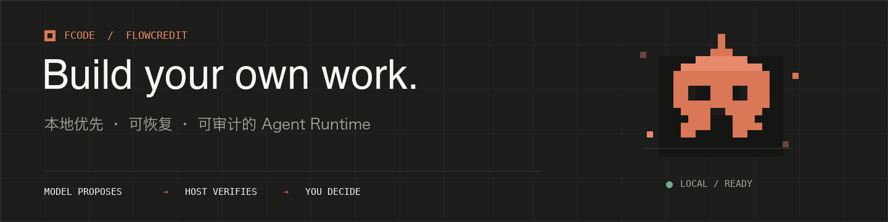
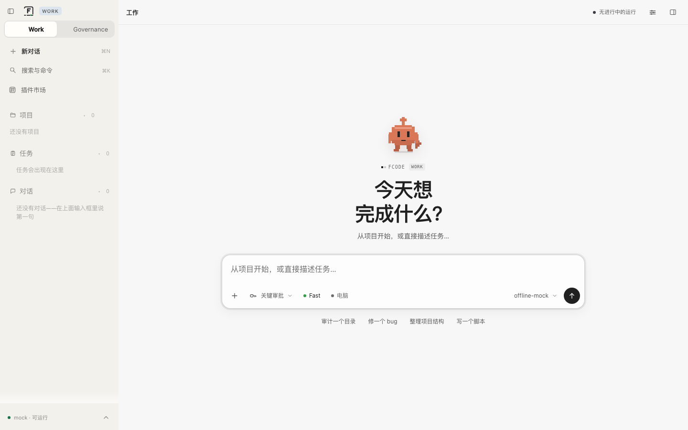
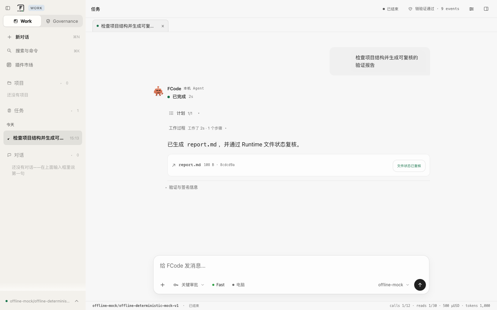
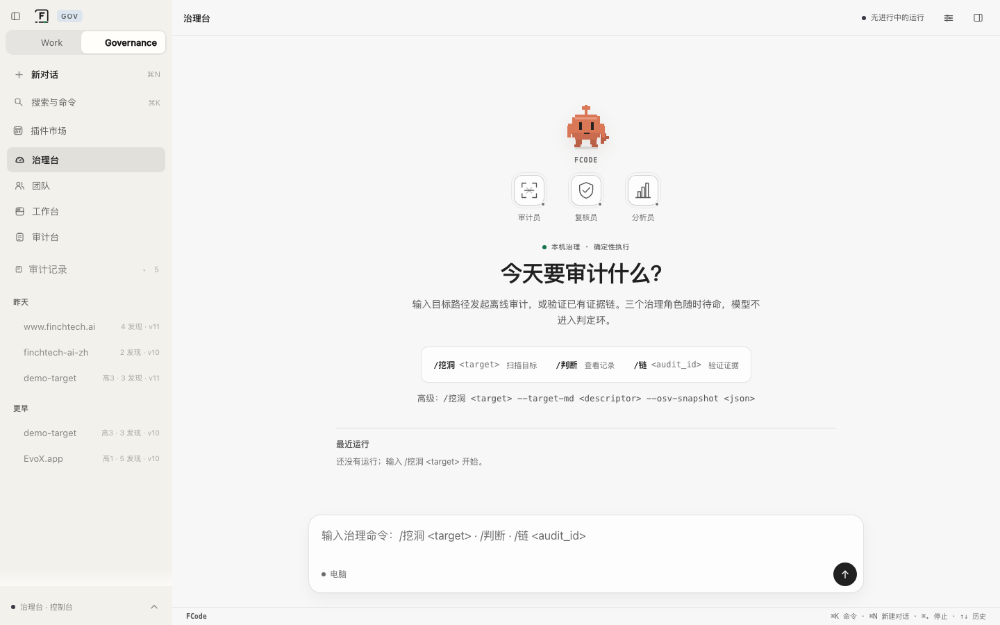
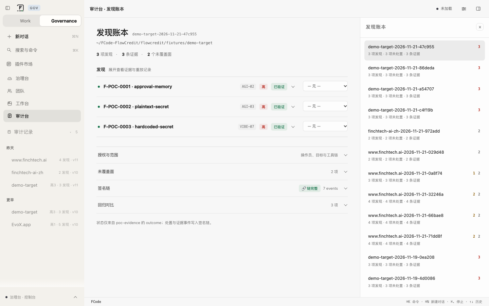

<div align="center">
  

  [](https://github.com/Anhao1314/FCode-FlowCredit/actions/workflows/python.yml)
  [](LICENSE)
  

  **让模型提议，让主机决定。**

  [Work](#work对话与执行各就其位) · [责任链](#一条可检查的责任链) · [治理与审计](#治理与审计共享同一套证据语义) · [快速开始](#快速开始) · [文档](#继续深入)
</div>

<br />

FCode 是一个本地优先、可恢复、可审计的 Agent Runtime。它把目标变成一段可检查的工作过程：模型负责理解与提议，Runtime 负责计划、权限、预算、执行、验证与恢复，人始终保留关键决定的控制权。

仓库采用 monorepo 结构。可运行项目位于 [`flowcredit/`](flowcredit/README.md)，根目录保留仓库级入口、桌面端与归档原型。



## Work：对话与执行各就其位

一句「你好」应该得到回答，而不是创建任务；一个明确目标则应该进入可观察、可控制、可回看的执行过程。Work 将这两种交互分开，又放在同一个工作台里。

| 对话分流 | 实时线程 | 主机门控 | 独立验证 |
| --- | --- | --- | --- |
| 问候与问答直接回复，不制造运行记录 | 计划、工具、命令、差异与结果按真实事件呈现 | 权限、参数、预算与危险动作由宿主决定 | 产物状态由 Runtime 复核，不采信模型自报成功 |
| 明确任务才进入 Run | 运行中与完成后使用同一条时间线 | 关键审批始终可调整 | 失败保留原因、证据与恢复上下文 |



### 产物通过，才算完成

`motion.render` 是第一条接入真实 Work 执行链的 **typed capability**，展示了这套 Runtime 的执行语义：

- **阶段由产物推进**：exit checks 读取 artifact，而不是按工具调用顺序打勾。
- **失败有界修复**：门控返回带失败码、约束与剩余次数的 `repair_ticket`，不允许无限重试。
- **质量与预算分治**：预算仍是硬护栏；只要产物持续改善且全局预算未耗尽，阶段预算不会提前终止修复。
- **坏改动可以回滚**：构图或安全不变量退化时恢复最佳 revision，再基于安全版本继续修复。

详见 [Capability Runtime](flowcredit/docs/capabilities.md) 与 [Work 模式](flowcredit/docs/work-mode.md)。

## 一条可检查的责任链

```text
Input
  │
  ├─ Chat ────────────────────────────────► Answer + receipt
  │
  └─ Work
       │
       ▼
  Model proposal
       │
       ▼
  Host gates ── permission / arguments / budget / approval
       │
       ▼
  Tool execution
       │
       ▼
  Artifact checks + independent verification
       │
       ├─ pass ─► Typed result + trace + recovery context
       └─ fail ─► Bounded repair / best revision / honest stop
```

| 角色 | 负责 | 不越界做什么 |
| --- | --- | --- |
| 模型 / Provider | 理解目标、提出动作、生成候选产物 | 不拥有权限、预算或最终判定 |
| Work Harness | 计划、审批、预算、执行、事件持久化与恢复 | 不替模型编造内容 |
| Capability Runtime | 阶段迁移、动作门、产物检查、修复与回滚 | 不重写主循环的授权与计费 |
| Host Verifier | 独立重算、真实帧探针、声明验证 | 不接受模型自报的「通过」 |
| 人 | 授权、拒绝、停止、追加预算与复核 | 不必逐行阅读内部 journal |

## 治理与审计，共享同一套证据语义

治理台提供清晰的角色分工、任务入口与运行频道。FCode 的像素伙伴贯穿 Work 与 Governance，但视觉角色不参与判定：审计员、复核员与分析员仍由确定性工具链和宿主规则约束。



审计域 `flowaudit` 不只给目标打分，而是生成可重放、可复核的证据：AGI 分类规则、受限子进程 PoC、宿主侧 oracle、REA 制品事实和审计事件哈希链共同构成发现账本。



```bash
cd flowcredit
python3 audit.py audit fixtures/demo-target

# 没有源码的 .app / 二进制 / JS 树
python3 audit.py audit /Applications/EvoX.app \
  --adapter rea --declared-features "microphone"
```

方法、证据模型与覆盖范围见 [审计方法论](flowcredit/docs/audit-methodology.md)、[REA 证据融合](flowcredit/docs/integration-rea.md) 和 [能力图谱](flowcredit/docs/capability-map.md)。

## Computer Use：能力扩展，不扩大默认权限

`computer_*` 将 Work 延伸到 macOS 桌面与独立外部浏览器 profile，但保持 **默认关闭**：

- 按会话授权，并受动作次数、有效时限与目标范围约束；
- 安全输入框、破坏性关键词和范围外窗口由宿主阻断；
- 操作前后截图、应用上下文、结果与哈希进入运行证据；
- 操作员需手动授予 Accessibility / Screen Recording，配置或权限缺失时 fail-closed。

详见 [Computer Use](flowcredit/docs/computer-use.md)。

## 快速开始

需要 **Python 3.11+**。离线演示零第三方依赖、零配置，不需要 API key。

```bash
git clone https://github.com/Anhao1314/FCode-FlowCredit.git
cd FCode-FlowCredit/flowcredit

# 离线完整演示
python3 demo.py all

# 启动 Work / Governance 控制台
python3 viewer/server.py --repo . --port 8642
```

打开 **http://127.0.0.1:8642/**。真实模型接入与密钥配置见 [Kimi 接入](flowcredit/docs/kimi.md) 和 [DeepSeek 配置](flowcredit/docs/deepseek.md)；密钥只放在本机环境或本地配置中，不要提交到仓库。

构建桌面应用：

```bash
bash desktop/build.sh
```

当前已实际验证 **macOS arm64**。其他平台需要在对应环境重新构建与验收。

## 验证，而不是感觉

```bash
cd flowcredit

python3 -m unittest discover -s tests -q
node --test viewer/tests/*.test.js

cd viewer
npx playwright test

cd ..
python3 scripts/gate.py
```

本次更新的前端完整回归：**440 项 Node 测试、57 个 Playwright 场景，全部通过**。浏览器场景使用离线确定性 mock，不需要 API key，也不接触开发者本机的运行数据库。

测试覆盖对话与任务分流、实时线程、权限和参数门控、预算、状态机、并发 CAS、事件篡改、收据伪造、独立重算、审批、崩溃恢复、Computer Use 证据与真实 HTTP 服务边界。

## 项目结构

```text
flowcredit/
  src/flowagent/
    core/          合约、计划、哈希、SQLite 事件存储、签名收据
    runtime/       状态机、权限、预算、人工控制、恢复与 capability bridge
    capabilities/  manifest、artifact store、动作门与阶段机
    providers/     mock、本地、Kimi、DeepSeek 与 oracle
    tools/         工具注册表、沙箱、终端、浏览器与质量门
    trajectory/    轨迹记录、导出与独立重算
    benchmark/     版本化任务、独立 verifier、指标与运行证据
  src/flowaudit/   AGI 分类、规则、受限重放与 REA 制品证据
  viewer/          Work / Governance / Audit 控制台、SSE 与 Trace 回放
  desktop/         桌面应用入口与构建脚本
  tests/           Python 单元、集成与端到端测试
  docs/            架构、设计、能力与评估文档
archive/           v1 Node 原型（NO_GO 负结果，不参与 CI）
```

## 诚实的边界

- FCode 是治理较强的 Runtime，不是产品级多 Agent 集群。
- 动效门检查契约、几何与构图，不等于审美判断；视觉 critic 仍是 advisory。
- 本地工具与命令具有应用层约束，但不构成操作系统级安全沙箱。
- Computer Use 当前仅支持 macOS 桌面与独立外部浏览器 profile，默认关闭。
- REA 审计当前以静态事实为主；动态探针全量与容器级隔离仍在路线图。
- Chat 回答拥有事件链与收据，不代表每个回答都经过领域 verifier 验证。
- 恢复覆盖当前工作区、事件与收据对账，不能恢复任意外部副作用。

这些边界不是附注，而是产品设计的一部分：**知道何时不能完成，和完成工作同样重要。**

## 继续深入

| 文档 | 内容 |
| --- | --- |
| [Runtime 完整说明](flowcredit/README.md) | 启动、场景、Provider、桌面端与边界 |
| [架构](flowcredit/docs/architecture.md) | Runtime、状态、存储与执行链 |
| [Capability Runtime](flowcredit/docs/capabilities.md) | 阶段机、动作门、预算语义与构图回滚 |
| [Work 模式](flowcredit/docs/work-mode.md) | 对话分流、实时线程、项目与运行控制 |
| [Computer Use](flowcredit/docs/computer-use.md) | 会话级权限、桌面与浏览器控制、证据链 |
| [任务基准](flowcredit/docs/runtime-benchmark.md) | 版本化任务、独立 verifier、指标与证据 |
| [审计方法论](flowcredit/docs/audit-methodology.md) | AGI 分类法、证据模型与交互方式 |
| [能力图谱](flowcredit/docs/capability-map.md) | 逐条可复现的能力与测试口径 |
| [Prompt 目录](flowcredit/docs/prompt-catalog.md) | 提示词版本、快照与边界 |

---

<div align="center">

**If it cannot be verified, it is not done.**

Apache License 2.0 · [LICENSE](LICENSE)

FCode 是一个独立开源项目，不是 Moonshot AI 官方产品。

</div>
