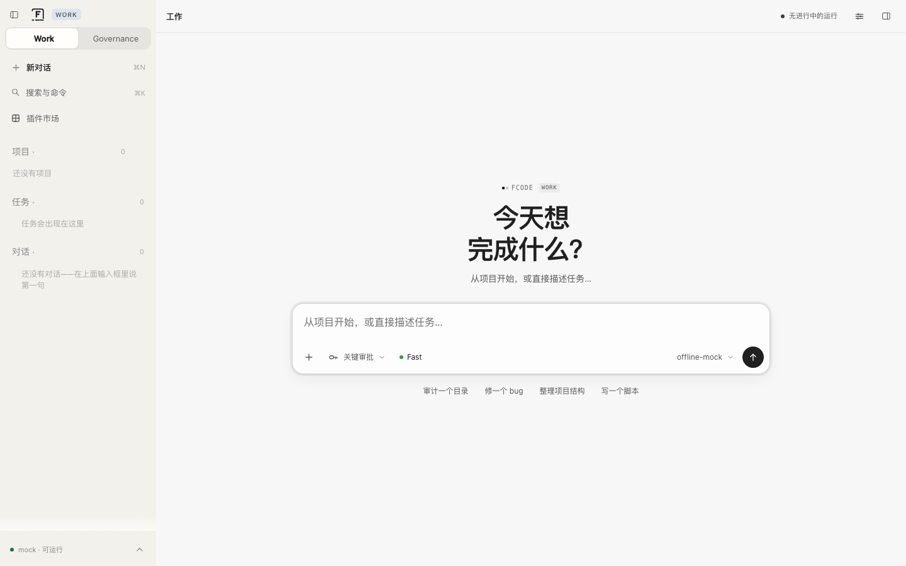
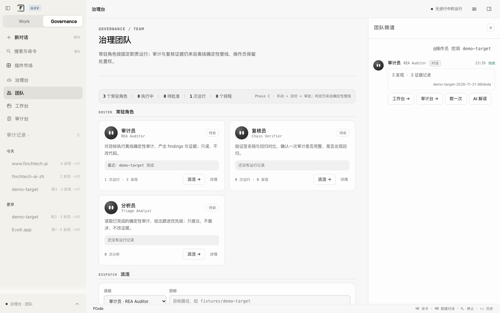

<div align="center">
  

  # FCode

  ## Build your own work.

  **让模型提议，让主机决定。**

  一个本地优先、可恢复、可审计的 Agent Runtime。

  `MODEL PROPOSES · HOST VERIFIES · YOU DECIDE`

  [](https://github.com/Anhao1314/FCode-FlowCredit/actions/workflows/python.yml)
  [](LICENSE)
  

  
  
</div>

---

FCode 把目标变成一段可检查的工作过程：模型负责理解与提议，Runtime 负责计划、权限、预算、执行、验证与恢复，人始终保留关键决定的控制权。

它不是另一个把模型输出包装成聊天气泡的壳。它关心的是更难的一组问题：读了哪些证据，调用了什么工具，为什么被允许执行，失败后能否修复，结果能否由独立过程复算，以及什么时候应该诚实地停下。

仓库是 monorepo 结构：可运行的项目在 [`flowcredit/`](flowcredit/README.md)，根目录保留仓库级入口、桌面端与归档原型。

## 这一版：Work 是通用 agent，能力有类型

Work 首先是通用 chat agent：理解目标、读写代码、执行命令、检查页面、整理证据、交付文件，也可以只回答一个问题。`motion.render` 不是一条写死的产品 workflow，而是宿主在合适场景下选择的一条 **typed capability**。

```text
Work agent
   │  host routes a typed capability
   ▼
motion.render: draft → structure → motion → delivery
   │  exit checks read the artifact itself
   ▼
typed result + quality + budget + reason
```

这条能力路径有三个刻意设计：

**阶段只由产物推进。** `draft`、`structure`、`motion`、`delivery` 不按工具调用顺序结算，也不相信模型说“做好了”。每个阶段的 exit checks 读取当前 artifact 的字节；静态检查、真实浏览器帧探针、覆盖项和最终验证共同决定能不能进入下一阶段。

**失败可以修，但不能无限重试。** 门拒绝动作时返回有界 `repair_ticket`（失败码、违反的约束、剩余 repair 次数、artifact hash），下一轮带着它继续修。每个失败码有独立上限；repair 用尽才失败。预算拆成 `model_calls`、`valid_actions`、`repairs` 与 `attempts`，不再把“模型调用了几次”和“产物真正改对了几次”混成一个数字。

**质量优先，预算是护栏。** stage budget 不再单独终止 run；只要 artifact 仍在改善且全局预算未耗尽，runtime 会继续修。停止条件是综合质量排序上的 no-progress（连续 3 个有效编辑没有超过 best candidate），或全局预算耗尽。best revision 按综合质量保存，失败时如果 best candidate 仍更好，会先恢复它再返回。

**坏改动可以回滚。** Runtime 保存最后一次构图安全的 revision。后续编辑如果把轮子或主体移出 scene，会记录 `artifact_rolled_back`，恢复 best revision，并发出 `COMPOSITION_REGRESSION`；模型必须回到安全版本上继续修，不能靠牺牲构图换取局部指标。

### 一次工作里，谁负责什么

| 角色 | 负责 | 不负责 |
| --- | --- | --- |
| 模型 / Provider | 理解目标、提出动作、生成候选产物 | 不拥有权限、预算或最终判定 |
| Work Harness | 计划、审批、预算、工具执行、持久事件、恢复 | 不替模型编造内容 |
| Capability Runtime | 阶段迁移、动作门、artifact 检查、修复票据、回滚 | 不重写主循环的计费与授权 |
| Host Verifier | 独立重算、真实帧探针、声明验证 | 不接受模型自报的“通过” |
| 人 | 授权、拒绝、追加预算、停止、复核 | 不需要逐行读内部 journal |

## 不是“计划完成”，是“产物通过”

动效交付是一个很好的压力测试，因为它同时考验计划、工具、上下文、物理理解和验证。FCode 对单文件 HTML/SVG/CSS 动画的门包括：

- **静态契约**：必需的动画名、DOM hooks、scene 结构与禁用项；
- **真实帧探针**：Playwright 在 150/450/750/1050 ms 采样，测量脚与支撑面距离、髋锚点、腿长、腿端点、腿/轮重叠；
- **构图不变量**：scene 与所有轮子的 bounding box、至少两个轮子、轮子与主体不出画（允许 2 px 贴边）；
- **coverage**：缺一项测量就是 `unverified`，不是默认 100 分；
- **最终验证**：独立 verifier 通过后，才允许产生 typed success。

失败码也是类型化的：`NO_TOOL_CALL`、`INVALID_TOOL_CALL`、`ACTION_REJECTED`、`ARTIFACT_CHECK_FAILED`、`BUDGET_EXHAUSTED_REASONING`、`ACTION_REPAIR_EXHAUSTED_*` 等分别归因；旧的 `NO_DRAFT` / `STATIC_CHECK_FAILED` / `PROBE_NOT_PASS` 只作为兼容别名保留。

### 一个真实的失败样本

鹈鹕骑自行车，单文件 HTML/SVG/CSS，`deepseek-flash`，真实 Playwright，独立 verifier：

| 指标 | 结果 |
| --- | --- |
| 耗时 / 调用 | 611.7 s，8 / 10 calls |
| Token / 成本 | 155,425 / 300,000；75,350 / 200,000 µUSD |
| 有效动作 / repair | 7 valid actions，0 repairs |
| 产物 | 4,743 B，coverage 9/9 |
| 构图 / 几何 | composition pass；脚-踏板 0 px、腿端点 0 px、腿长 73 px |
| 终态 | **failed**，`ARTIFACT_CHECK_FAILED` |
| 未通过项（旧测量器） | 报告轮速 188 px/s vs 背景 94 px/s；该静态测量无法区分 180° 与 360°，已被修复 |

这个旧样本先暴露的是验证器自身的问题：旧检查默认每个周期转满 360°，因此 180° 旋转也会被报成同样的 50% slip。修复后的新样本表现不同：263.0 s / 5 calls / 65,055 tokens / 29,721 µUSD，quality pass，coverage 9/9，轮子实际转 360°，轮速 302 vs 背景 300（0.66%）。它仍然失败在 delivery：声明验证要求 `pelican` / `bicycle` 文本或 class，而模型没有收到这个契约。物理一致性已经过第一道门；下一步是把 raw prompt、scene descriptor 与 verifier contract 显式传给模型，并给 delivery 失败一个有界修复窗口。

## 审计域仍然在

同一个 Runtime 之上，FCode 还有审计域 `flowaudit`：审计其他 agent 应用，而不是只给它们打分。

- AGI 九类漏洞分类法，规则即数据；
- PoC 在受限子进程中重放，宿主侧 oracle 判定；
- 发现附带可重放证据，审计事件本身进哈希链；
- REA 制品证据覆盖 Go 构建信息、bundle 解剖、entitlements 与 sidecar 静态事实；
- 审计器用自己的仓库和 19 个版本化 Runtime 任务自检。

```bash
cd flowcredit
python3 audit.py audit fixtures/demo-target

# 制品审计：没有源码的 .app / 二进制 / JS 树
python3 audit.py audit /Applications/EvoX.app \
  --adapter rea --declared-features "microphone"
```

审计台读取 `work/audit/<audit_id>/` 的 bundle 与 PoC Evidence，不执行目标。启动 Work 控制台后从侧栏「审计台」进入（`#/audit`；旧 `/audit.html` 链接会 302 到新入口）。

网站目标走治理团队（`/挖洞 <url>`）：先做治理化快照（robots、响应头、溯源），再审计快照目录；规则集 v11 的 WEB-01–WEB-07 覆盖第三方脚本、SRI、内联事件、`eval`、sourcemap、安全响应头与运行时第三方源。治理对话另有制度层（`GOVERNANCE.md`）、分段快照、压缩与四个只读 JIT 工具，详见 [治理上下文与记忆核心](flowcredit/docs/gov-memory.md)。

审计台与方法见 [审计方法论](flowcredit/docs/audit-methodology.md)、[REA 证据融合](flowcredit/docs/integration-rea.md) 和 [能力图谱](flowcredit/docs/capability-map.md)。

## 快速开始

需要 **Python 3.11+**。离线演示零第三方依赖、零配置。

```bash
git clone https://github.com/Anhao1314/FCode-FlowCredit.git
cd FCode-FlowCredit/flowcredit

python3 demo.py all
```

打开 Work 控制台：

```bash
python3 viewer/server.py --repo . --port 8642
# http://127.0.0.1:8642/
```

默认落在 **Work 工作台**：项目、运行看板与待处理事项；Chat、任务历史、审批、轨迹回放和运行控制仍在同一壳内。

真实模型接入与密钥配置见 [Kimi 接入](flowcredit/docs/kimi.md) 和 [DeepSeek 配置](flowcredit/docs/deepseek.md)。密钥只放在本机环境或本地配置中，不要提交到仓库。

复现实验里的鹈鹕样本：

```bash
python3 scripts/evaluate_work_pelican.py --output /tmp/fcode-pelican-eval
```

脚本读取本机已保存的 provider 配置，默认硬限制为 10 calls / 300k tokens / 200,000 µUSD，并输出脱敏 `report.json`、workspace 与运动帧。

### 构建桌面应用

```bash
bash desktop/build.sh
```

当前已实际验证 **macOS arm64**。其他平台需要对应环境重新构建与验收，不能由一次 macOS 构建推定可用。

## 验证，而不是感觉

```bash
python3 -m unittest discover -s tests -q       # 1,476 Python tests
node --test viewer/tests/*.test.js              # 418 frontend tests
python3 scripts/gate.py                         # backend / frontend / benchmark / audit / e2e
```

当前完整回归：**1,476 项 Python 测试、418 项前端测试、36 个 Playwright 场景、19 个版本化 Runtime 任务**。CI 在 Ubuntu / macOS × Python 3.11 / 3.13 上重新推导，并断言 Runtime 依赖为 `[]`。

测试覆盖权限与参数门控、预算、状态机、并发 CAS、事件篡改、收据伪造、独立重算、审批与计划控制、崩溃恢复、Provider 纪律、修复票据、构图回滚，以及真实 HTTP 服务边界。

## 项目结构

```text
flowcredit/
  src/flowagent/
    core/        合约、计划、哈希、SQLite 事件存储、签名收据
    runtime/     状态机、权限、预算、人工控制、循环、恢复与 capability bridge
    capabilities/ typed capability：manifest、artifact store、gate、阶段机
    providers/   mock、本地、Kimi、DeepSeek 与 oracle
    memory/      从事件日志重建模型可见上下文
    tools/       工具注册表、沙箱、终端、浏览器与动效质量门
    trajectory/  轨迹记录、导出与独立重算
    benchmark/   版本化任务、独立 verifier、指标与真实运行证据
  src/flowaudit/ 审计域：AGI 分类法、规则、受限重放、REA 制品证据
  viewer/        Work / Chat / Audit 控制台、SSE、Trace 回放
  desktop/       桌面应用入口与构建脚本
  tests/         Python 单元、集成与端到端测试
  docs/          架构、设计、能力与评估文档
archive/          v1 Node 原型（NO_GO 负结果，不参与 CI）
```

## 诚实的边界

- FCode 当前是治理较强的 **单 Agent Runtime**，不是产品级多 Agent 集群。
- `motion.render` 是第一条接入真实 Work 执行链的 typed capability；其他 capability 仍是库级能力，不自动路由。
- 动效门测量的是契约、几何和构图，不是审美；Jev 视觉 critic 仍是 advisory，不接运行终态。
- 上面的鹈鹕结果是一个在线失败样本，不是统计意义上的模型对比；当前仍未通过轮速/背景速度一致性。
- 本地工具与命令有应用层约束，但不构成操作系统级安全沙箱。
- REA 审计当前以静态事实为主；动态探针全量、容器级隔离仍在路线图。
- Chat 回答拥有事件链与收据，不代表每个回答都经过领域 verifier 验证。
- 恢复覆盖当前工作区、事件与收据对账，不能恢复任意外部副作用。

这些边界不是附注，而是产品设计的一部分：知道何时不能完成，和完成工作同样重要。

## 继续深入

| 文档 | 内容 |
| --- | --- |
| [Runtime 完整说明](flowcredit/README.md) | 启动、场景、Provider、桌面端与边界 |
| [架构](flowcredit/docs/architecture.md) | Runtime、状态、存储与执行链 |
| [Capability Runtime](flowcredit/docs/capabilities.md) | 阶段机、动作门、预算语义、构图回滚 |
| [能力图谱](flowcredit/docs/capability-map.md) | 逐条可复现的能力与测试口径 |
| [Work 模式](flowcredit/docs/work-mode.md) | 项目实体、运行看板与待处理队列 |
| [任务基准](flowcredit/docs/runtime-benchmark.md) | 19 项任务、独立 verifier、指标与证据 |
| [审计方法论](flowcredit/docs/audit-methodology.md) | AGI 分类法、证据模型与交互方式 |
| [REA 证据融合](flowcredit/docs/integration-rea.md) | 制品审计与声明覆盖 |
| [Prompt 目录](flowcredit/docs/prompt-catalog.md) | 提示词版本、快照与边界 |
| [Jev 视觉 critic](flowcredit/docs/jev-visual-critic.md) | advisory 第二意见与 false negative |

---

<div align="center">

**If it cannot be verified, it is not done.**

Apache License 2.0 · [LICENSE](LICENSE)

FCode 是一个独立开源项目，不是 Moonshot AI 官方产品。

</div>
