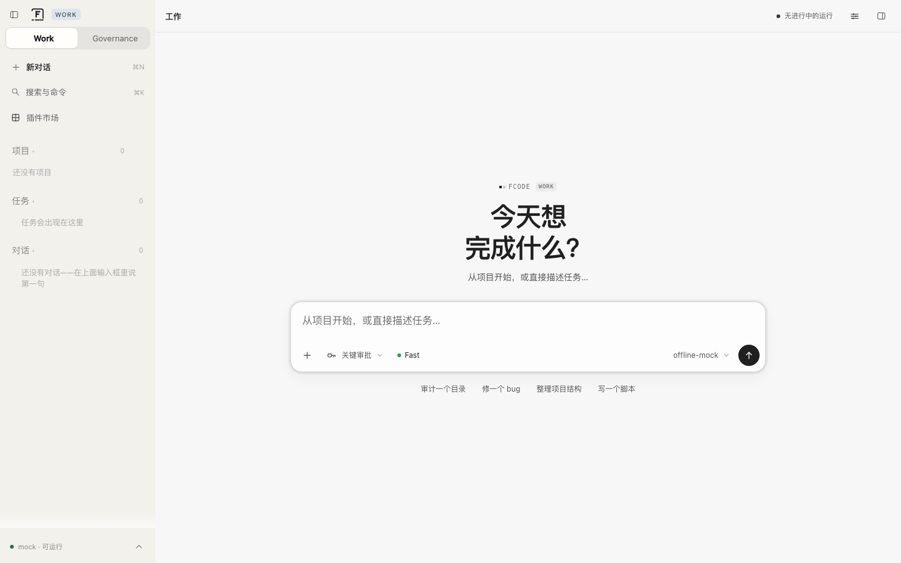
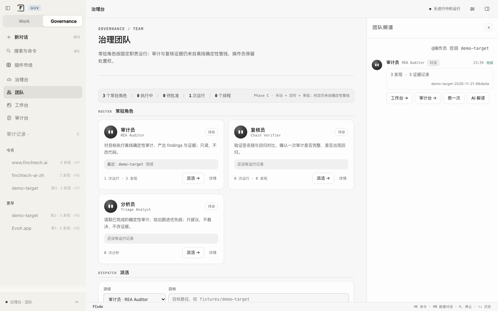
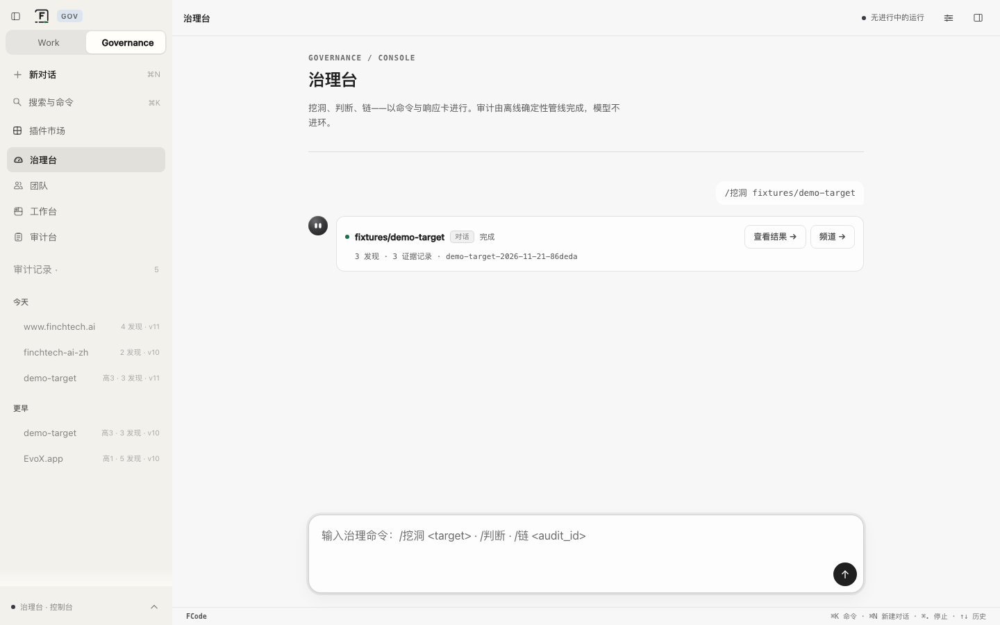

<div align="center">
  

  # FCode

  ## Build your own work.

  **让模型提议，让主机决定。**

  一个本地优先、可恢复、可审计的 Agent Runtime。

  `MODEL PROPOSES · HOST VERIFIES · YOU DECIDE`

  
  
</div>

---

FCode 把目标变成一段可检查的工作过程：模型负责理解与提议，Runtime 负责计划、权限、预算、执行、验证与恢复，人始终保留关键决定的控制权。

Python 包名为 `flowagent`。金融研究是第一个示例域，运行内核本身不绑定行业。

## 不是更会回答，而是更能负责

一个 Agent 说自己完成了，并不等于工作真的完成。

在这个内核之上，FCode 构建了审计域 `flowaudit`——审计其他 agent 应用的 agent，见仓库首页与 [能力图谱](docs/capability-map.md)。

FCode 更关心另一组问题：它读了哪些证据，调用了什么工具，为什么被允许执行，失败后能否恢复，结果能否由独立过程复算。可信不来自模型的自述，而来自可验证的运行记录。

### 三条约束

**模型不掌权**

工具来自封闭注册表。参数先通过 schema 校验，再同时匹配任务范围与主机授权；模型不能绕过门控，也不能自行宣布成功。

**失败不乱来**

调用在发送前计入预算。结果未知的请求不盲目重发，进程崩溃后从事件日志重建状态，已完成的轮次不重复执行。

**全程可审计**

审批、工具调用、观测、预算与人工干预进入同一条哈希链。读取时重新计算链，任何篡改都会暴露，而不是只给日志染一个颜色。

## 四个核心，一条责任链

| 核心 | FCode 的实现 | 当前边界 |
| --- | --- | --- |
| **大脑 / Brain** | Provider 抽象；支持 mock、本地与 OpenAI 兼容模型；模型输出动作提议 | 模型能力不等于任务已被验证 |
| **规划 / Planning** | 目标分解、todo、轮次循环、计划跳过与提前、失败停止 | 当前以单 Agent 的计划执行为主 |
| **记忆 / Memory** | SQLite 事件日志、操作员长期记忆与相关召回、上下文重建、运行历史、断点续跑 | 不是无限记忆，也不等于跨任务知识系统 |
| **工具 / Tools** | 封闭注册表、参数校验、权限门控、预算控制、签名收据 | 受限命令不是操作系统级沙箱 |

```text
Model proposal → Schema → Tool registry → Permissions / Budget / Approval
                                                              │
                                                              ↓
SQLite events ← Independent verifier ← Receipt ← Tool execution
      │                                                        │
      └──────────── Crash recovery / read-only replay ─────────┘

The model proposes. The host gates, executes and verifies.
```

Runtime 不只记录“做了什么”，还记录“为什么允许做”。独立 verifier 可以重算领域结果；验证不通过，运行就不能被伪装成成功。

## 启动 FCode

需要 **Python 3.11+**。离线演示零第三方依赖、零配置。

```bash
git clone https://github.com/Anhao1314/FCode-FlowCredit.git
cd FCode-FlowCredit/flowcredit
python demo.py
```

终端会显示场景菜单；无交互终端时直接运行完整故事。

### 打开 Work 控制台

在 `flowcredit` 目录执行：

```bash
python viewer/server.py --repo . --port 8642
```

打开 `http://127.0.0.1:8642/`。默认落在 **Work 工作台**：项目、运行看板与待处理事项；Chat、任务历史、审批、轨迹回放和运行控制仍在同一壳内。

### 打开审计台

同一服务提供只读的发现账本：

```bash
python audit.py audit fixtures/demo-target
# 浏览器打开 http://127.0.0.1:8642/ → 侧栏「审计台」(或直接 #/audit；旧 /audit.html 链接 302 到 #/audit)
```

制品审计（没有源码的 `.app` / 二进制 / JS 树）用 REA 证据：

```bash
python audit.py audit /Applications/EvoX.app \
  --adapter rea --declared-features "microphone"
```

审计台读取 `work/audit/<audit_id>/` 的 bundle 与 PoC Evidence，不执行目标；
方法见 [REA 制品证据融合](docs/integration-rea.md)。

### 解剖一个网站时，实际发生了什么

Web 目标走治理化链路，不在 CLI 里直接抓 URL：

- **治理化快照**：按 robots 与同源策略抓取，记录 UA、出口、robots 判定、页面覆盖与跳过原因；资产带哈希，部署锚点只存哈希与计数，便于下次直接 diff。
- **运行时证据**：可选 Playwright 观察面记录真实第三方 origin、控制台错误、同源链接与存储键名（不取值）；挑战页如实记为证据，不破解。
- **规则集 v11**：30 条活跃规则（AGI 10 / VIBE 13 / WEB 7），新增 WEB-01–WEB-07 覆盖第三方脚本、SRI、内联事件、`eval`、sourcemap、安全响应头、运行时第三方源。
- **隐私与留存**：中性 UA / 可选出口代理 / 浏览器级请求头；审计目录可整体 AES-256 加密归档（`*.tar.enc`），默认保留 5 份。
- **受控覆盖**：同源子页面按上限与节流抓取，跳过原因逐条记录。

真实站点验证：3 页受控覆盖、28 个静态资产、4 个运行时第三方 origin，产出 4 条发现——两条 medium 为缺失 5/6 安全响应头与运行时直连 Web3Modal / WalletConnect 等外部服务；所有发现都有 probe/control 双跑、负对照与重放收据。

### 一条线程，看清工作

Work 把执行过程组织成 **项目 → 运行 → 状态／计划 → 工具与审批 → 最终回复**，不再用互相割裂的卡片拼接进度：

- **项目是服务端实体**：目录、验证命令与归档状态持久化在 `projects.sqlite`；项目与运行都在侧栏导航，项目行展开即见其运行，主区只显示选中的任务/对话线程。

- **同一事实，两种视图**：实时运行与历史重开共用统一线程投影；普通项目和完整研究使用相同的阅读结构。
- **结果可以展开核对**：工具默认保持一行摘要，展开后查看参数、命令、真实 diff、原始输出与签名收据。diff 来自沙箱的实际前后内容，不由前端推测。
- **审批属于具体一轮**：提交后只禁用当前审批并显示等待状态，下一轮审批不会被旧状态卡住；`?run=` 与 `?trace=` 深链始终进入 Work。
- **项目交付保持隔离**：普通项目在独立副本中执行，交付 `FCODE_RESULT.md`，通过独立验证后可切换执行、变更和文件视图。
- **动效交付带确定性质量门**：单文件 HTML/SVG 动画在 0/300/600/900 ms 采样，检查脚-支撑面距离（≤25 px，支撑面可以是 `.pedal`/`.deck`/`.support`）、腿/轮包围盒、`.hip` 髋锚点、腿长与腿端点；报告带 `coverage`，缺失测量显示「质量未验证」而不是 100 分。contact sheet、覆盖项和具体 issues 直接出现在最终回复，不依赖模型自述。
- **Chat 连续对话不串线**：流式回答按线程与世代隔离；完成或停止后立即发送下一条，不会被旧回读覆盖，分页与归档也不会带回失效列表。

### 治理团队怎么记住上下文

- **制度层**：`GOVERNANCE.md` 按用户 → 项目 → 本机三层加载，`@path` 导入最多 4 跳，合并文本哈希随每轮 `chat_context` 事件入链；
- **工作记忆**：快照按角色 / 待批准 / 最近运行 / 最近审计 / 最近计划 / 最近判断六段分配预算，最新优先、整行裁剪；
- **压缩**：超过阈值时调用九段式摘要器，`chat_compact` 记录摘要哈希与 usage，下一轮重新注入；
- **按需检索**：四个只读工具 `list_audits` / `read_audit` / `read_run` / `read_memory`，结果带 `result_hash` 与不可信标记入链；模型不能写长期记忆。

完整设计见 [治理上下文与记忆核心](docs/gov-memory.md)。



真实模型接入与 Provider 配置见 [Kimi 接入说明](docs/kimi.md)。密钥只放在本机环境或本地配置中，不要提交到仓库。

### 构建桌面应用

```bash
bash desktop/build.sh
```

当前已实际验证 **macOS arm64** 构建。其他平台需要对应环境重新构建与验收，不能由一次 macOS 构建推定可用。

## 八个可复现场景

```bash
python demo.py full          # 完整研究：多轮取证、口径桥接、独立复算
python demo.py tool-denied   # 越权工具：主机拒绝，工具不执行
python demo.py budget        # 预算耗尽：发送前拦截
python demo.py budget-resume # 追加预算：失败后续跑
python demo.py crash         # 真实 SIGKILL：恢复后不重复轮次
python demo.py unknown       # 结果未知：不重发，凭收据对账
python demo.py open-ended    # 证据不足：诚实停止
python demo.py general-research # 通用研究：开放目标与证据整理
python demo.py all           # 顺序运行全部场景并自检轨迹
```

这些场景不是八套硬编码流程。它们复用同一个 Runtime，通过不同主机策略与故障注入，检验权限、预算、恢复、验证与停止纪律。

每次运行都会生成 `work/demo/<scenario>.trace.json`。可以阅读原始事件，也可以在控制台回放轨迹并验证哈希链。

## 人如何介入

控制发生在执行链中，而不是运行结束后的解释里。

- **审批**：通过门控后、工具执行前暂停；拒绝终止运行，超时自动拒绝。提交状态绑定审批 id，不会泄漏到下一轮。
- **计划修订**：跳过或提前计划项，在下一轮边界生效。
- **预算调整**：失败后追加预算并续跑，已支付的读取不重复发送。
- **运行中消息**：在轮次边界进入上下文，并写入同一条事件链。
- **判断记录**：将授权、阻塞、恢复与关键决定呈现为可检查的工作历史。

## 验证，而不是感觉

```bash
python -m unittest discover -s tests -q
node --test viewer/tests/*.test.js
python demo.py all
PYTHONPATH=src python -m flowagent.benchmark --output work/runtime-benchmark/latest
```

当前完整回归：**1,495 项 Python 测试（含审计域 flowaudit 的契约与端到端测试）、435 项前端测试、49 个端到端场景、19 个版本化 Runtime 任务**。数字口径与逐条复现命令见 [能力图谱](docs/capability-map.md)。原生桌面验收另覆盖真实项目交付、连续审批、工具 diff／命令输出，以及实时与历史线程一致性。

任务基准的离线实测为：独立 verifier `18/19`（保留一个预置错误交付）、崩溃恢复 `3/3`、未知结果安全处理 `3/3`、回放等价 `18/18`、篡改检测 `1/1`，越权与重复副作用均为 `0`。正常链和 SIGKILL 证据见 [任务基准](docs/runtime-benchmark.md)；这不是实际模型成功率，本轮 `ONLINE_MODEL=NOT_RUN`。

测试覆盖权限与参数门控、预算、状态机、并发 CAS、事件篡改、收据伪造、独立重算、审批与计划控制、崩溃恢复、Provider 纪律，以及真实 HTTP 服务边界。CI 使用 Ubuntu／macOS × Python 3.11／3.13 矩阵。

## 诚实的边界

- FCode 当前是治理较强的**单 Agent Runtime**，不是产品级多 Agent 集群。
- 本地工具与命令有应用层约束，但不构成操作系统级安全沙箱。
- Web 审计只覆盖客户端快照：robots 与反自动化挑战可能阻断，服务端行为、鉴权绕过与动态利用不在覆盖内；`retire`、`gitleaks`、Playwright、`openssl` 都是可选外部依赖，缺失时如实降级。
- 外部扫描器结果会合并进 bundle API，但审计库暂未渲染；`webcrack` 仍是实验性工具，不自动运行。
- 审计目录加密需显式开启（`FCODE_AUDIT_ENCRYPT=1`），默认不加密；加密归档默认保留 5 份。
- REA 制品审计覆盖静态事实（Go 构建信息 / bundle 解剖 / entitlements / sidecar 静态扫描）；完整 sidecar JS 图与动态探针仍在路线图。
- Chat 附件目前以文本注入为主，不等于完整多模态理解管线。
- `search_codebase` 是 BM25 倒排检索，不是向量语义检索；首次检索会懒构建索引（本仓库约 0.8s），之后只读快照，运行中新建的文件要用 `grep_workspace`/`read_file` 查看。
- Fast 批量只读工具在原生 `Loop` 中并发派发；写/网络/终端仍串行，LangGraph 引擎保持顺序步骤节点。
- `browser_inspect` 只打开 `127.0.0.1 / localhost / ::1` 预览，依赖可选的 Playwright sidecar；外部 URL、文件 URL 与非本机子资源一律拒绝。
- `browser_act`（click/fill/press）是 write effect，按 Work 当前审批档位执行；Fast/自动运行不额外暂停，Governance 负责审计与人工复核。每次保留操作前/后截图、操作后 DOM、DOM 文本 diff 和截图变化摘要。
- `computer_*` 默认关闭：只有操作员在工作台显式开启、并批准一次会话级授权后，模型才能操作 allowlist 内的 macOS 应用或外部域名。会话不可扩大或续期，安全输入框与破坏性关键词由宿主阻断；只支持 macOS 桌面与独立外部浏览器 profile，不读写剪贴板、不执行 shell、不导入浏览器凭据。详见 [Computer Use](docs/computer-use.md)。
- 同一工作区的浏览器检查/交互复用一条持久 Chromium 会话（空闲 5 分钟回收）；像素级截图比例依赖可选的 Pillow，缺失时退化为哈希/尺寸变化。
- Chat 回答拥有事件链与收据，不代表每个回答都经过领域 verifier 验证。
- 恢复只覆盖当前工作区、事件与收据对账，不能恢复任意外部副作用；通用任务仍受模型能力与可验证性限制。

这些边界不是附注，而是产品设计的一部分：知道何时不能完成，和完成工作同样重要。

## 继续深入

| 文档 | 内容 |
| --- | --- |
| [架构](docs/architecture.md) | Runtime、状态、存储与执行链 |
| [任务基准](docs/runtime-benchmark.md) | 19 项任务、独立 verifier、指标与证据路径 |
| [演示脚本](docs/demo-script.md) | 正常链、审批拒绝、SIGKILL 与 verifier 拒绝 |
| [环境配置](docs/environment.md) | 离线运行、可选 Provider 与命令白名单示例 |
| [Computer Use](docs/computer-use.md) | 会话级桌面/浏览器控制、权限链、证据与失败码 |
| [设计哲学](docs/philosophy.md) | 为什么把控制权交给主机与人 |
| [通用能力](docs/general-capabilities.md) | 从金融示例到领域无关内核 |
| [上下文管理](docs/context-management.md) | 记忆、压缩与事件重建 |
| [多 Agent 实验](docs/multi-agent-lab.md) | 多 Agent 方向的边界与探索 |
| [视觉系统](docs/design-system.md) | 黑白、留白、轨道与证据语言 |
| [Work 模式](docs/work-mode.md) | 项目实体、运行看板与待处理队列的当前边界 |
| [治理解释层](docs/gov-explainer.md) | 模型解释确定性证据（非裁决）的边界与 API |
| [审计员 triage](docs/gov-triage.md) | 模型只提议跟进优先级；影子/受控两档，复扫需批准 |
| [Jev 视觉 critic](docs/jev-visual-critic.md) | 用图像型 System One 给动效做 advisory 第二意见，不接终态 |
| [治理运行流](docs/gov-runs.md) | 对话/团队/定时共用一条运行流：来源、预算与审批语义 |
| [治理对话](docs/gov-chat.md) | 正常模型对话 + `gov_action` 提案确认；模型不进裁决 |
| [治理上下文与记忆核心](docs/gov-memory.md) | 制度文件、分段快照、压缩与只读 JIT 工具 |
| [目标级蜂群](docs/gov-swarm.md) | 多目标 fan-out：宿主并发调度、取消/重试与运行图 |
| [Fixer 修复通道](docs/gov-fixes.md) | 补丁隔离验证、人工批准、写回与自动复扫 |
| [桌面设计](docs/desktop-design.md) | Work 控制台的结构与交互 |
| [重构评估](docs/refactor-evaluation.md) | 技术债、模块边界与演进记录 |

## 项目结构

```text
src/flowagent/
  core/        合约、计划、哈希、SQLite 事件存储、签名收据
  runtime/     状态机、权限、预算、人工控制、循环与恢复
  providers/   mock、本地、Kimi、DeepSeek 与 oracle
  memory/      从事件日志重建模型可见上下文
  tools/       工具注册表与金融示例工具
  trajectory/  轨迹记录、导出与独立重算
  demo/        CLI、终端渲染与八个可复现场景
  benchmark/   版本化任务、独立 verifier、指标与真实运行证据
src/flowaudit/  审计域：AGI 分类法、规则、受限重放、REA 制品证据
viewer/        Work / Chat / Audit 控制台、SSE、Trace 回放
  core/        前端纯函数与交互状态
  tests/       前端回归测试
desktop/       桌面应用入口与构建脚本
tests/         Python 单元、集成与端到端测试
docs/          架构、设计、能力与评估文档
```

---

<div align="center">

**If it cannot be verified, it is not done.**

FCode 是一个独立开源项目，不是 Moonshot AI 官方产品。

</div>
